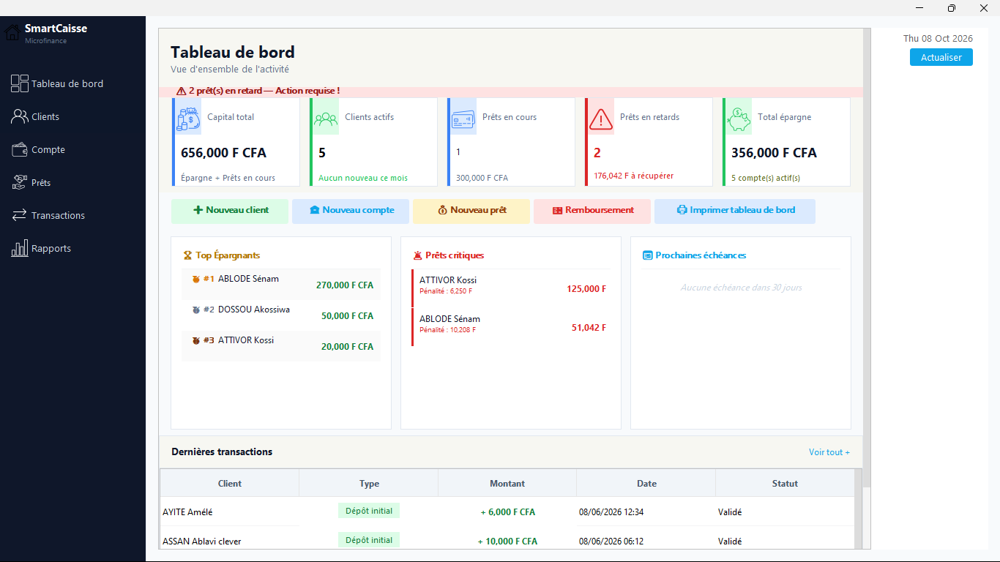

# SmartCaisse

Application de bureau (Windows) de gestion d'une structure de microfinance : clients, comptes, prêts, remboursements, transactions, rapports.



## Le problème

Les petites structures de microfinance doivent suivre prêts et remboursements au quotidien, mais les logiciels existants sont chers et peu adaptés au contexte local (montants en F CFA, épargne, tontine).

## Fonctionnalités

- **Clients** : fiche complète, modification, détail.
- **Comptes** : plusieurs types (courant, à terme, tontine), solde, clôture, numéro de compte unique.
- **Prêts** : création avec taux et durée, intérêts simples (`capital × taux × durée / 1200`, taux annuel en %), suivi des remboursements.
- **Règles d'éligibilité** appliquées automatiquement avant tout prêt : aucun prêt en cours sur le compte, compte ouvert depuis au moins 3 mois, solde minimum de 5 000 F CFA.
- **Pénalités de retard** : 5 % du reste dû par mois de retard.
- **Transactions** : dépôt, retrait, virement, remboursement.
- **Tableau de bord** avec alerte sur les **prêts critiques** et les échéances.
- **Documents** : reçu de remboursement, contrat de prêt, rapport journalier (PDF) ; états de gestion et export CSV lisible dans Excel.
- Connexion avec comptes utilisateurs actifs / inactifs.

## Stack

Java (projet NetBeans configuré pour Java 25) · Swing · FlatLaf · MariaDB / MySQL via JDBC (pilote MariaDB Connector/J) · iText (PDF) · JFreeChart · installeur Inno Setup qui embarque Java et MariaDB.

## Architecture

```
src/Models/   Client, Compte, Pret, Transaction, Utilisateur
src/DAO/      accès à la base + règles métier des prêts (PretDAO)
src/Views/    interfaces Swing
src/Utils/    impression PDF et états
lib/          bibliothèques .jar
```

## Essayer l'application (le plus simple)

1. Télécharger `SmartCaisse_Setup_v1.0.exe` dans la page [Releases](https://github.com/clever75/SmartCaisse/releases) et lancer l'installeur (droits administrateur demandés).
2. L'installeur met en place l'application, **sa propre base MariaDB** (service Windows `SmartCaisseDB`, port 3308, accessible uniquement depuis votre PC), les tables et un compte de démonstration. Rien d'autre à installer.
3. Lancer SmartCaisse et se connecter avec le compte de démonstration ci-dessous.

## Compte de démonstration

| Identifiant | Mot de passe |
|-------------|--------------|
| `demo`      | `demo1234`   |

Compte fictif créé par l'installeur, uniquement pour tester.

## Installation pour le développement

Prérequis : JDK (le projet NetBeans est configuré pour Java 25 ; si votre JDK est plus ancien, adapter *Project Properties → Sources → Source/Binary Format*), NetBeans, MariaDB ou MySQL (XAMPP convient).

1. Créer la base `smartcaisse`, puis importer `database/schema.sql` (tables) et `database/seed.sql` (compte de démonstration).
2. Ouvrir le dossier dans NetBeans et lancer le projet (classe principale `Views.LoginFrame`).

La connexion à la base se règle dans un fichier `config.properties` placé à côté de l'application (jamais envoyé sur GitHub). **Sans ce fichier**, l'application utilise les réglages de développement `localhost:3306`, utilisateur `root`, mot de passe vide (XAMPP). Format du fichier :

```properties
db.host=127.0.0.1
db.port=3306
db.name=smartcaisse
db.user=root
db.password=
```

## Ce que j'ai appris

- Traduire une logique métier financière (intérêts, pénalités, échéances, éligibilité) en code, puis en interface claire.
- Garder la cohérence des données quand plusieurs opérations dépendent les unes des autres (solde, remboursement, statut du prêt).
- Générer des documents PDF (reçus, contrats) avec iText.

## Limites connues et pistes d'amélioration

- Les mots de passe des utilisateurs de l'application sont stockés en clair dans la table `Utilisateur` : remplacement par BCrypt prévu.
- Pas de tests automatisés sur les calculs financiers, qui en auraient pourtant le plus besoin.

## Contexte

Projet réalisé en 2026 dans le cadre du BTS en développement d'applications à DEFITECH (Lomé).

**Auteur** : ASSAN Ablavi Clever, [GitHub](https://github.com/clever75)
